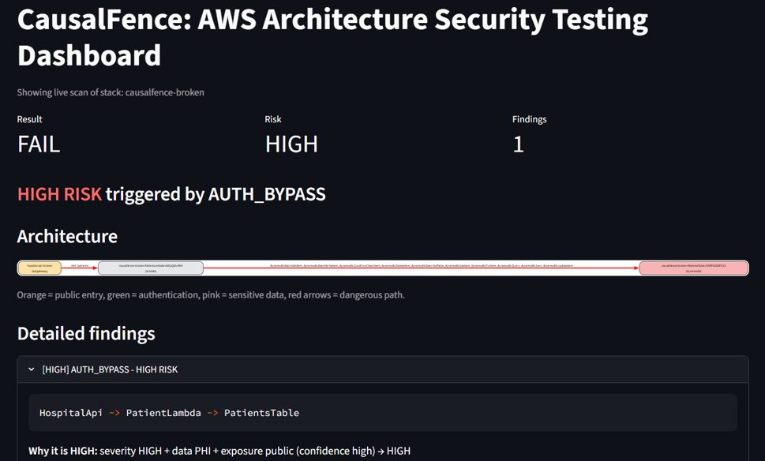
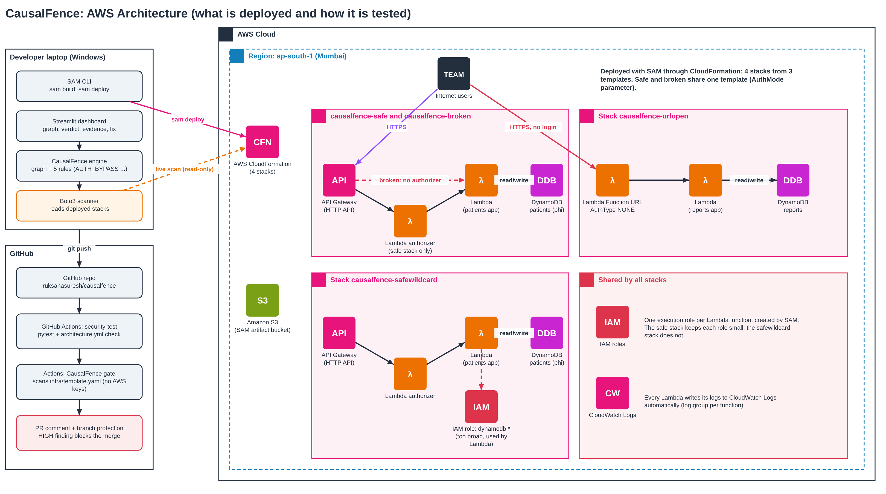
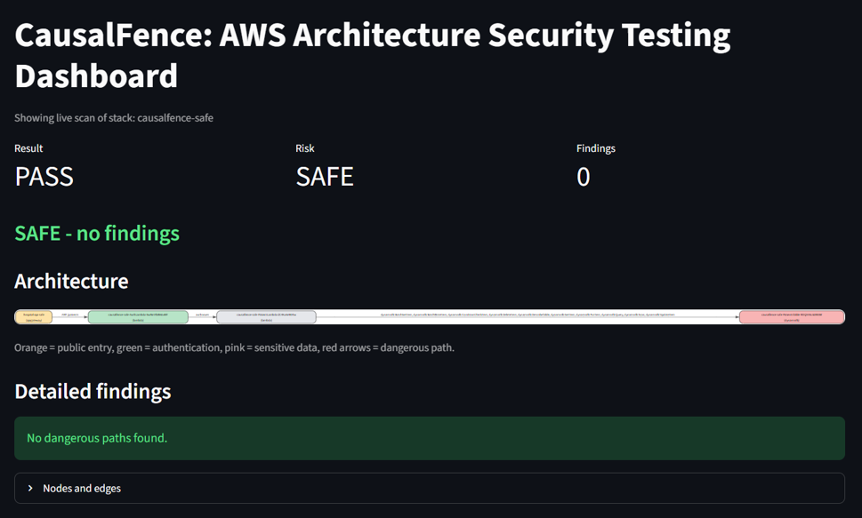
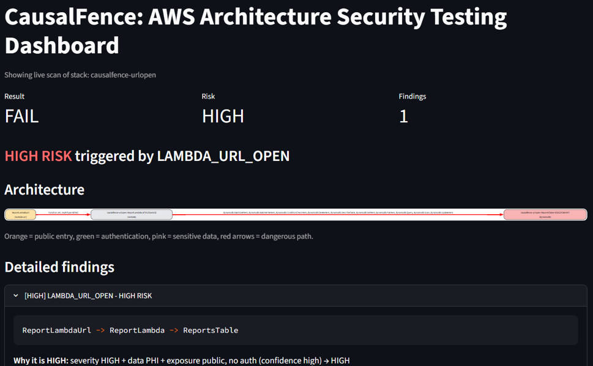
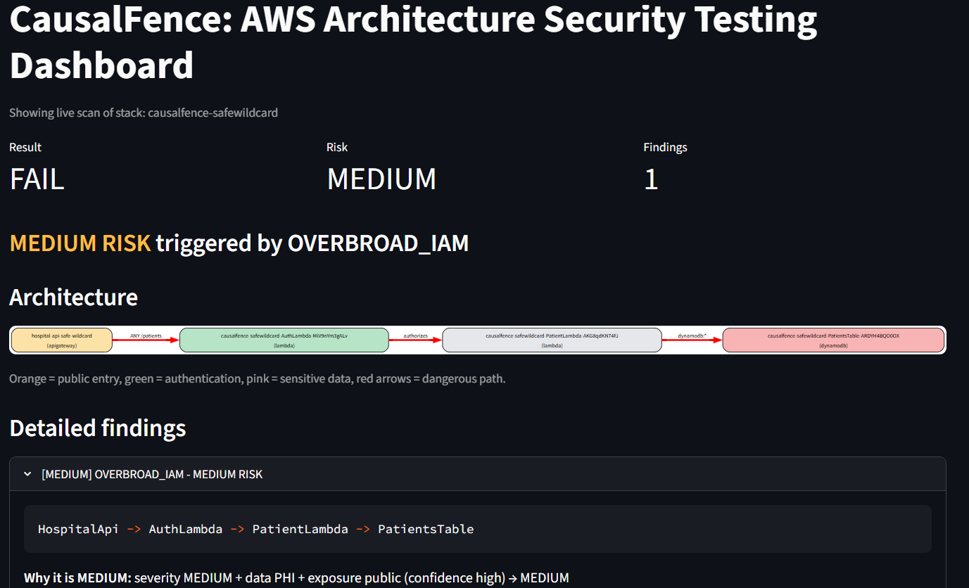

# CausalFence

**An AWS architecture security tester that follows the path, not just the setting.**

CausalFence reads an AWS serverless architecture and checks one thing: *can someone on the internet reach sensitive data without passing through authentication?* It builds a graph of your resources, finds every route from a public entry point to the data, and reports a clear verdict (**SAFE**, **MEDIUM** or **HIGH**) with the exact path, the evidence, and a copy-paste fix.

[Presentation](docs/CausalFence-Presentation.pdf) | [Architecture](#architecture) | [Quick start](#quick-start)

It runs in three places: on your laptop, in a Streamlit dashboard, and as a GitHub Actions gate that blocks risky pull requests before they are merged.



## Why

Most checks look at one resource at a time: *"is the API protected?"*, *"is the table encrypted?"*. Each can pass while the route as a whole is open. A new API route can skip the authorizer, the Lambda does not know which route called it, and the table never asks who the caller is. CausalFence checks the whole path from the internet to the data instead.

## How it works

1. **Build a graph.** Each AWS resource becomes a node and each connection an edge. The graph comes from either source below.
2. **Find the paths.** Every route from a public entry point to a sensitive node (a DynamoDB table tagged `sensitivity=phi`) is traced.
3. **Run the rules.** Five rules look at those paths.
4. **Give a verdict.** Severity, data sensitivity and exposure are combined into SAFE, MEDIUM or HIGH. It is never just a bare number.
5. **Explain it.** Each finding shows the path, the evidence (file and line, or `[live AWS scan]`), why it matters, and a fix.

| Graph source | Reads | AWS keys | Used for |
|---|---|---|---|
| Template parser (`iac_parser`) | The SAM / CloudFormation file | No | The GitHub gate, before deploy |
| Boto3 scanner (`scanner`) | The stack that is actually deployed | Yes, read-only | Dashboard live scan, command line, catching drift |

### The five rules

| Rule | Severity | What it catches |
|---|---|---|
| `AUTH_BYPASS` | HIGH | A public entry reaches sensitive data with no authentication on the path |
| `PUBLIC_DB_EXPOSURE` | CRITICAL | A public entry connects straight to the database |
| `LAMBDA_URL_OPEN` | HIGH | A Lambda Function URL with `AuthType: NONE` |
| `OVERBROAD_IAM` | MEDIUM | A wildcard permission (such as `dynamodb:*`) on a path from a public entry to sensitive data |
| `PUBLIC_S3_BUCKET` | HIGH | A publicly readable S3 bucket |

## Architecture



Four real stacks are deployed to `ap-south-1` (Mumbai) with AWS SAM, one correct and three with a deliberate mistake, so each rule is tested on real infrastructure.

| Stack | Design | Verdict |
|---|---|---|
| `causalfence-safe` | API Gateway with a Lambda authorizer | **SAFE** |
| `causalfence-broken` | Same app, authorizer removed | **HIGH**, `AUTH_BYPASS` |
| `causalfence-urlopen` | Public Lambda Function URL, no login | **HIGH**, `LAMBDA_URL_OPEN` |
| `causalfence-safewildcard` | Authorizer present, but the Lambda role allows `dynamodb:*` | **MEDIUM**, `OVERBROAD_IAM` |

The data in these stacks is fake. No real patient information is used.

## Results on the real stacks

Each screenshot is a live scan from the dashboard (**Scan live AWS stack**), reading the deployed stack through Boto3.

<table>
  <tr>
    <td width="50%"><br><b>causalfence-safe</b><br>PASS, SAFE. Login sits on the path.</td>
    <td width="50%"><br><b>causalfence-broken</b><br>HIGH, <code>AUTH_BYPASS</code>. The route skips the authorizer.</td>
  </tr>
  <tr>
    <td width="50%"><br><b>causalfence-urlopen</b><br>HIGH, <code>LAMBDA_URL_OPEN</code>. A public URL with no login.</td>
    <td width="50%"><br><b>causalfence-safewildcard</b><br>MEDIUM, <code>OVERBROAD_IAM</code>. Login is fine, the IAM role is too wide.</td>
  </tr>
</table>

## Quick start

Requires Python 3.13.

```bash
git clone https://github.com/ruksanasuresh/causalfence.git
cd causalfence
python -m venv .venv
.venv\Scripts\activate        # Windows (macOS/Linux: source .venv/bin/activate)
pip install networkx pyyaml streamlit boto3 pytest
```

**Run the tests**

```bash
python -m pytest -q
```

**Scan a template (no AWS login needed)**

```bash
python -m causalfence.ci --template infra/template.yaml --param AuthMode=safe     # SAFE
python -m causalfence.ci --template infra/template.yaml --param AuthMode=broken   # HIGH, AUTH_BYPASS
python -m causalfence.ci --template infra/demo-stacks/urlopen-app.yaml            # HIGH, LAMBDA_URL_OPEN
```

The command exits with code `1` when a finding exists, which is what makes the GitHub check go red.

**Scan a deployed stack (needs your own AWS login, read-only)**

```bash
python -m causalfence.scanner <stack-name> --region ap-south-1
python -m causalfence graphs/live-<stack-name>.yml
```

**Open the dashboard**

```bash
streamlit run dashboard/app.py
```

Choose **Graph file** to open a saved graph, or **Scan live AWS stack** to pick a deployed stack and click **Scan now**.

## GitHub gate

Every pull request runs the **security-test** job (pytest and the architecture check) and the **CausalFence gate**, which scans the template with no AWS keys. The result is posted as a comment on the pull request, and branch protection blocks the merge while a finding is open.

## Project structure

```
causalfence/      engine, rules, risk scoring, template parser, Boto3 scanner, CI gate
dashboard/        Streamlit app
graphs/           saved architecture graphs
infra/            SAM template and the demo stacks
tests/            pytest suite
rules.yml         severity, remediation and fix snippet for each rule
```

## Limitations

- The GitHub gate scans `infra/template.yaml` with its default parameters.
- `PUBLIC_S3_BUCKET` is covered by unit tests on sample templates but has not been tried on real AWS.
- None of the four stacks triggers `PUBLIC_DB_EXPOSURE`.
- It looks for authentication on the path. It does not test whether the authentication logic itself is correct.

## Presentation

The project slides are in the repository: [View the presentation (PDF)](docs/CausalFence-Presentation.pdf).

## Author

**Ruksana S** (24MIS0293), Vellore Institute of Technology.
Built for the Agile Development and DevOps course.
